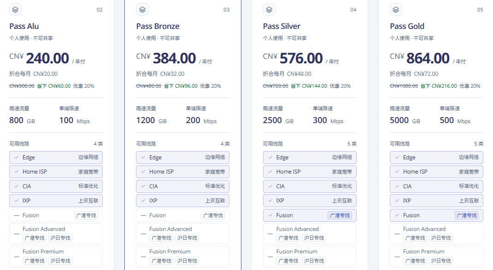

# oixcloud官网国内直连地址（原dlercloud）

最新地址：[oixcloud.com](https://oixcloud.com/r/r4eba48a120a5bd90)

备用地址：[oixcloud](https://todesk.io/r/r4eba48a120a5bd90)

## oixcloud简介

oixcloud，原DlerCloud，专门为用户提供高速稳定的网络代理服务。支持多种代理协议，像 Shadowsocks（SS）、V2Ray、Trojan 等，线路也特别丰富，有普通的直连节点、专线节点，甚至还有为企业设计的动态专线。不管是 Netflix、Disney+ 还是 YouTube Premium，它都能轻松解锁加速访问。

oixcloud 基于运营商或云服务商提供的高质量/高优先级的商业宽带，针对全国所有链路进行了优化，配合全新的隧道传输技术连接至海外。提供更高质量骨干承载网络而建立，延迟降低了50％；冻结率下降30％；丢包率低于0.05％。

## oixcloud特色

* 边缘网络 - Edge
* 精品网络 - GIA
* 游戏加速 - Gamer
* 专线连接 - IEPL (Lite)
* 专线连接 - IEPL (Std)
* 专线连接 - IEPL (Pro)

所有套餐为**周期一次性高速流量** + **无限**低速流量

## oixcloud套餐价格

低至 ￥240/年。

## oixcloud怎么样？

oixcloud，DlerCloud（墙洞）已经稳定运营多年，属于老牌IEPL专线国际网络加速器，线路稳定，晚高峰体验好，包含香港、台湾、新加坡、日本、美国等线路，稳定解锁Netfilx、Disney+、ChatGPT、Claude、Copilot、Gemini等服务，套餐价格也适中，非常适合追求稳定的人群。
